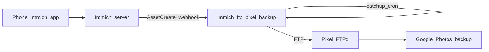

# immich-ftp-pixel-backup


**Bridge Immich uploads to a Pixel over FTP** so Google Photos on that phone can back them up to the cloud.

<br clear="left" />

[](https://github.com/natarajgithub/immich-ftp-pixel-backup/actions/workflows/ci.yml)
[](LICENSE)
[](https://www.python.org/downloads/)
[](docker-compose.yml)

## Why

Immich is a great private photo library, but many people still want Google Photos’ cloud features. Google does not offer a general “upload from NAS” Photos API for this. This project keeps Immich as the phone ingest, then pushes **new assets** to a dedicated Pixel via FTP into a folder Google Photos already backs up.

## How it works



1. A photo lands in Immich (mobile upload, web, etc.).
2. An Immich **AssetCreate** workflow POSTs to this service.
3. The service downloads the original and FTPs it to the user’s Pixel.
4. A periodic **catch-up** job fills gaps if a webhook was missed.
5. Google Photos on the Pixel backs up the new files from `DCIM/…`.

## Features

- Multi-user config (`users.yaml`) — each user has Immich API key, webhook token, FTP target
- Webhook + catch-up cron (global default, optional per-user override)
- Web portal: live status, config editor, FTP test, catch-up now
- Blank `/config` volume auto-seeds empty YAML on first boot
- Docker Compose ready

## Requirements

- Immich with **Workflows** (AssetCreate → webhook)
- An always-on (or often-on) Pixel with an FTP server (e.g. [Primitive FTPd](https://github.com/wolpi/prim-ftpd)) and Google Photos backup enabled for the target folder
- LAN reachability between Immich, this service, and the Pixel
- Docker **or** Python 3.12+

## Quick start (Docker)

```bash
git clone https://github.com/natarajgithub/immich-ftp-pixel-backup.git
cd immich-ftp-pixel-backup
mkdir -p runtime-config runtime-data
docker compose up -d --build
```

Open **http://localhost:8088/** (or your host IP).

1. **Settings → App** — set Immich URL (e.g. `http://immich:2283` or your LAN URL).
2. **Add user** — Immich sync API key, webhook token, FTP host/port/credentials, remote dir.
3. Click **Test FTP**.
4. Configure Immich workflow (below).
5. Upload a test photo and watch the dashboard counts / events.

> Mount `/config` **read-write**. Missing `app.yaml` / `users.yaml` are created automatically (`users: []`). Existing files are never overwritten.

Optional NAS-style overlay: [`docker-compose.nas.yml`](docker-compose.nas.yml).

## Immich workflow setup

Detailed steps: [docs/setup-immich.md](docs/setup-immich.md).

For each Immich user:

| Field | Value |
|-------|--------|
| Trigger | `AssetCreate` |
| Action | `immich-plugin-core#webhook` (Trigger Webhook) |
| URL | `http://<sync-host>:8088/hooks/<user_id>/asset-create` |
| Method | `POST` (dropdown — **do not** put `POST` inside the URL) |
| Header name | `X-Webhook-Token` |
| Header value | same token as in the portal / `users.yaml` |

Enable the workflow. The Immich API key needs permission to list/download that user’s assets (sync “reader” key).

## Pixel / FTP setup

Detailed steps: [docs/setup-pixel-ftp.md](docs/setup-pixel-ftp.md).

- Run FTP on the Pixel; keep the process alive while syncing.
- Use a directory Google Photos backs up (commonly under `DCIM/`, e.g. `/storage/emulated/0/DCIM/ImmichSync`).
- Ensure the sync host can reach `pixel:port` on the LAN.

## Web portal

- **Dashboard** — per-user counts, watermark, errors, failed assets, recent events (polls every 2s while visible)
- **Settings** — edit app + users YAML; **Test FTP**; **Catch up now**

**Security:** there is **no login**. Treat the portal as LAN-only. See [SECURITY.md](SECURITY.md).

## Config reference

| File | Purpose |
|------|---------|
| `app.yaml` | `immich_url`, default `catchup_cron`, DB path, HTTP bind |
| `users.yaml` | List of users: `id`, `immich_api_key`, `webhook_token`, optional `catchup_cron`, `ftp.*` |

Examples: [`config/app.example.yaml`](config/app.example.yaml), [`config/users.example.yaml`](config/users.example.yaml).  
SQLite schema: [docs/schema.md](docs/schema.md).

Effective catch-up cron = per-user value if set, else app default.

## Develop

```bash
python3 -m venv .venv && source .venv/bin/activate
pip install -e ".[dev]"
pytest
ruff check src tests
immich-ftp-pixel-backup --app-config config/app.yaml --users-config config/users.yaml
```

See [CONTRIBUTING.md](CONTRIBUTING.md).

## Limitations

- Pixel FTP must be reachable when uploads run
- Catch-up processes assets sequentially; overlapping webhooks may open parallel FTP sessions
- Google Photos backup timing/behavior is controlled by the Photos app, not this service
- Portal is intentionally unauthenticated (trusted network only)

## License

[MIT](LICENSE)
